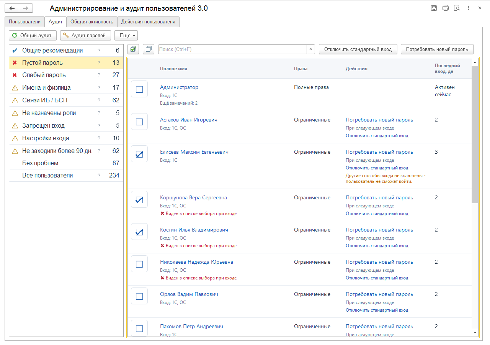
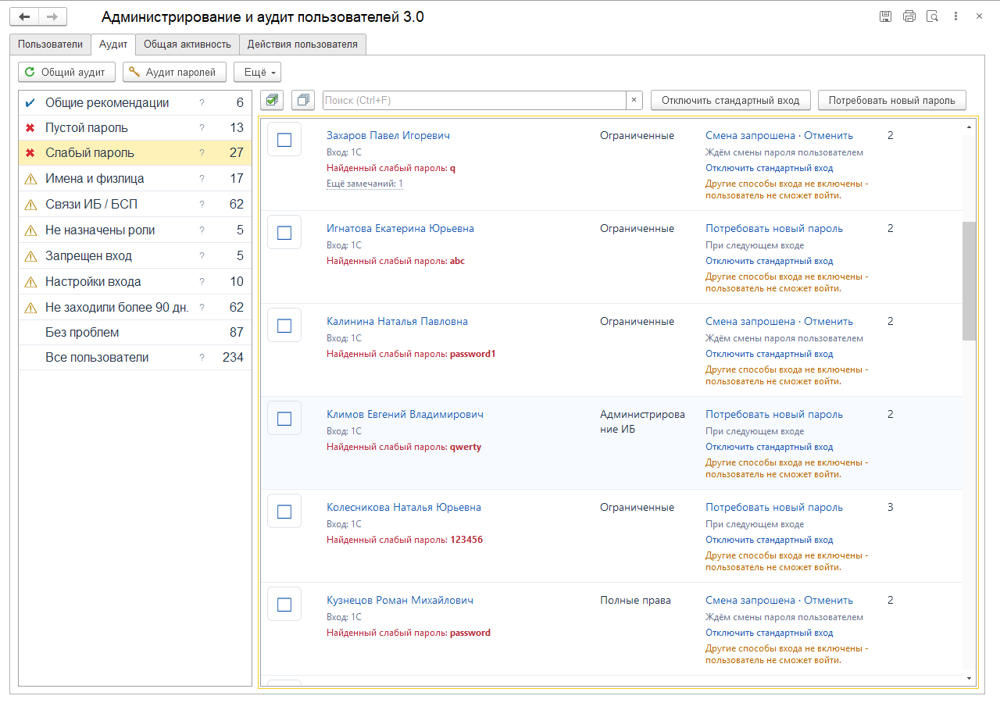
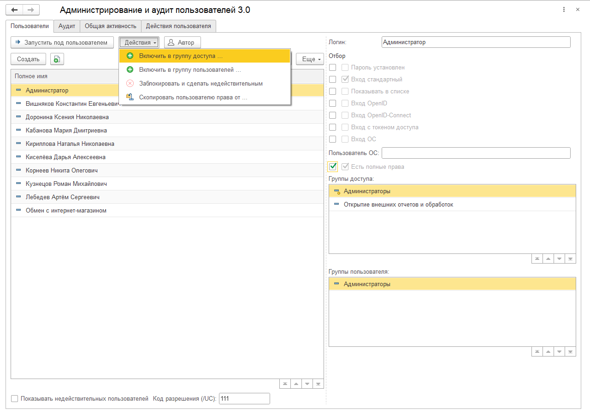
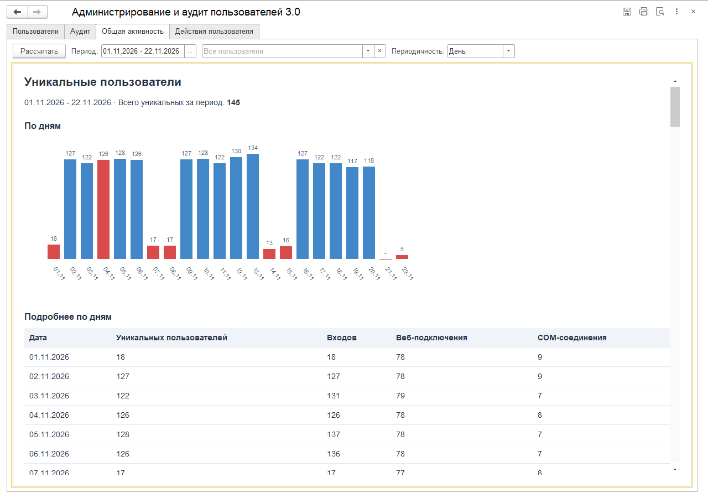
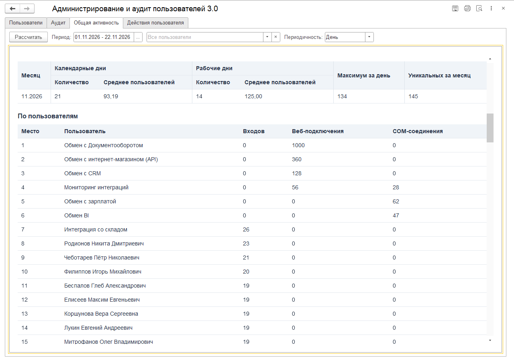
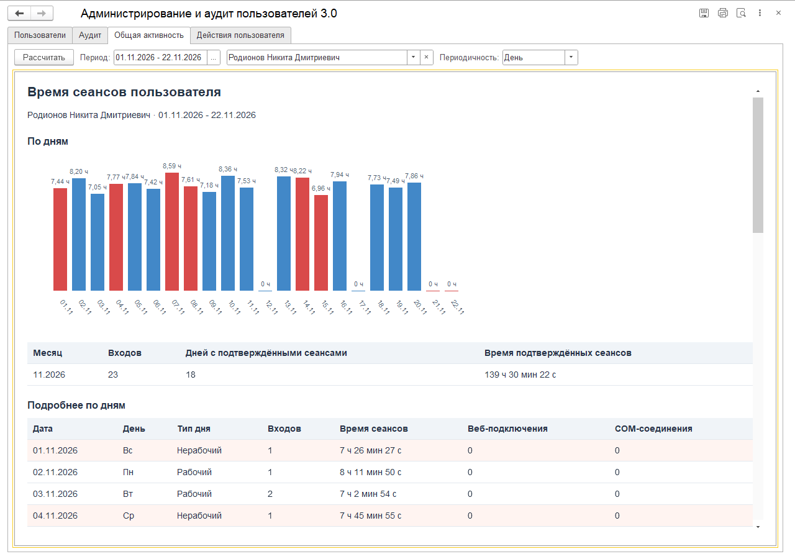
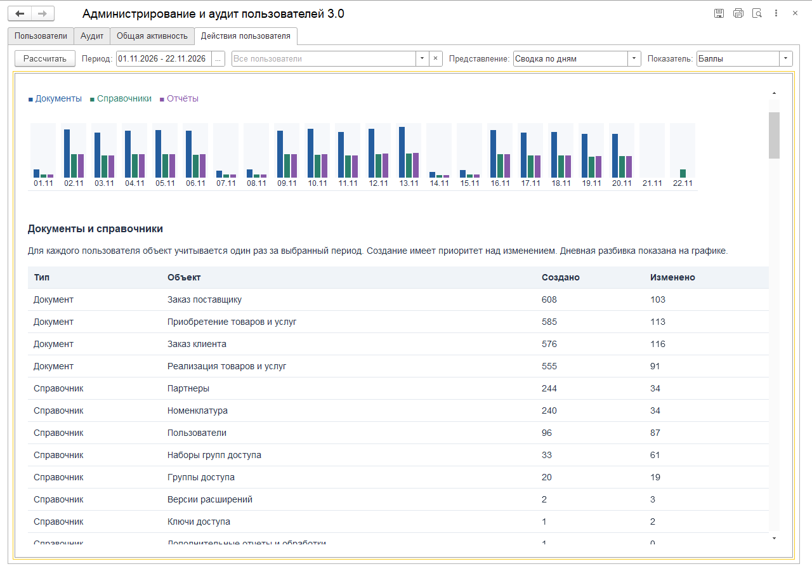

# Администрирование и аудит пользователей 1С

Обработка для полного аудита пользователей в информационной базе 1С и наведения порядка: список с отборами и быстрыми действиями (добавить/убрать/скопировать права, запустить сеанс от имени выбранного пользователя); Поиск уязвимостей и проблем, например слабые или пустые пароли; Анализ активности и действий пользователей.

За первые 16 месяцев [публикация на Инфостарте](https://infostart.ru/1c/tools/2421332/) набрала **5 661 просмотр и 72 скачивания**. Опубликована 7 июля 2025 года, статистика на 15 ноября 2026 года.

Версия 3.0 · [Релизы](https://github.com/FFXEka/onec-user-admin/releases) · [Сообщить об ошибке](https://github.com/FFXEka/onec-user-admin/issues)

Дмитрий Сушков ([FFXEka](https://github.com/FFXEka)) · [GPL-3.0-only](https://github.com/FFXEka/onec-user-admin/blob/main/LICENSE) · [Сторонние компоненты](https://github.com/FFXEka/onec-user-admin/blob/main/THIRD_PARTY_NOTICES.md)

## «Безопасность поправим потом»

Часто наблюдал картину, когда справочник пользователей в базах больше похож на архив сотрудников, без какого либо периодического аудита - какие-то пользователи с паролем "123", какие-то вообще без пароля. Кого-то при этом видно в списке пользователей. У части пользователей полные права, часть вообще не имеет права авторизации. Следить за этим довольно накладно, особенно когда баз много. А исправить старые простые пароли вообще нет возможности, т.к. они в базе не хранятся в прямом виде и их непросто обнаружить.

В обработке Администрирование и аудит пользователей мы за этим можем легко следить и исправлять.

*В демобазе 13 учёток без пароля. В первой строке — администратор с полными правами.*

## Увидеть то, до чего не доходили руки

Общий аудит показывает замечания по учётным записям, правам, способам входа и связям пользователей информационной базы (ИБ) и встроенного справочника Пользователей библиотеки стандартных подсистем (БСП). Отдельный «Аудит паролей» проверяет распространённые и предсказуемые варианты. Пароль каждого пользователя со стандартной аутентификацией проверяется среди примерно 2,5 млн. вариантов для SHA-1 (для PBKDF2 пулл сильно сокращён). Именно этот пулл показал себя лучше всего в тестах - оптимально по раскрытию слабых паролей и времени поиска. Найденные слабые пароли можем увидеть (заблокировано для публичной версии обработки) и сами принять решение оставлять его или потребовать сменить.

*На скриншоте прежняя сборка. В публичной версии у такой учётной записи видно сообщение «Найден слабый пароль.» Для одних пользователей смена пароля уже запрошена, для других её можно потребовать прямо из списка.*

## Пользователи и помощь без подключения к чужому экрану

На первой вкладке «Пользователи» — список с отборами: у кого полные права, кто входит через ОС, кто использует стандартную аутентификацию. Здесь же — копирование прав, включение в группы и исключение из них.

*Кому выданы полные права, видно по отбору справа. Из меню «Действия» можно включить пользователя в группу или скопировать ему права.*

У сотрудника странно работает отчёт или динамический список, а у администратора всё нормально. «Запустить под пользователем» позволяет открыть новый сеанс под нужной учёткой и проверить её настройки без подключения к компьютеру сотрудника и знания его пароля.

Механизм простой: обработка сохраняет исходное значение пароля — его хэш, задаёт случайный временный пароль и запускает второй тонкий клиент. По кнопке ОК или через 60 секунд при работающем исходном сеансе прежнее значение возвращается. Второй клиент продолжает работать.

**До возврата пароля исходный сеанс не закрываем.** Если он аварийно завершится, временный пароль может остаться - тогда придется его сбросить и установить новый пароль.

## А сколько людей действительно пользуется базой?

Утром в консоли 70 сеансов, днём 60, вечером 100. Кто работает, а кто просто оставил 1С открытой? Разовый взгляд на список сеансов мало что объясняет.

«Общая активность» показывает входы и пользователей по дням, среднее количество пользователей за период. Можно увидеть обычные рабочие дни (если в базе есть производственный календарь), выходные и изменение посещаемости базы. Также можем видеть какие пользователи являются служебными - через кого и как много в базу совершаются HTTP/WEB и COM соединения.

*За период в базу заходили 145 разных пользователей. На графике видно, как менялась посещаемость по дням.*

[Открыть полный отчёт по базе](demo/3.0/activity.html)

Средние за месяц, подключения и время сеансов

*В среднем за рабочий день — 125 пользователей. У обмена с Документооборотом за период 1 000 веб-подключений и ни одного входа в клиент.*

*У выбранного пользователя 23 входа за 18 дней. Ниже графика — длительность подтверждённых сеансов по датам.*

[Открыть отчёт по сеансам Родионова](demo/3.0/sessions.html)

«Действия пользователя» показывает время сеансов, работу с документами и справочниками, отчёты и события по часам. Видны периоды активности, затишье и работа по выходным. Для менеджеров, постоянно работающих в базе, это полезный материал для разбора загрузки.

Источником этих данных является журнал регистрации. Это нужно учесть, особенно в очень больших базах, где выборка по большому периоду может формироваться продолжительное время, и если журнал не ведется или база была перемещена (выгрузить/загрузить .dt), то этой информации увидеть не получится.

*На графике — документы, справочники и отчёты по дням. Ниже видно, сколько заказов, поступлений и реализаций создали или изменили.*

[Открыть полную сводку действий](demo/3.0/actions.html)

По пользователям, видам объектов и часам

*В таблице можно сравнить число действий по пользователям. Документы, справочники, отчёты и баллы вынесены в отдельные колонки.*

*У одного пользователя за период создан 21 документ, изменены ещё два. Ниже — какие отчёты он запускал и сколько раз.*

[Открыть отчёт по действиям Беспалова](demo/3.0/user-actions.html)

*У этого пользователя основная активность приходится на промежуток с 8 до 16 часов. На карте можно посмотреть, как она распределяется по дням недели.*

[Открыть карту активности за 24 часа](demo/3.0/hourly.html)

## Демо-стенд и совместимость

Были проведены тесты на разных поколениях платформы и БСП: от **8.3.10** до **8.3.27** и **8.5.1**. В проверках использовались файловые и серверные базы, Windows и Linux - ЕРП, БП, ЗУП, ДО, Розница 3.

| Платформа | Версии БСП в проверках |
| --- | --- |
| 8.3.10.2772 | 2.3.6.196 |
| 8.3.18.1483 | 3.1.3.523 |
| 8.3.22.2411 | 3.1.6.310, 3.1.7.526, 3.1.9.302, 3.1.9.209 |
| 8.3.24.1548 | 3.1.11.283 |
| 8.3.27.2325 | 3.1.12.323 |
| 8.5.1.1529 | 3.1.12.323, 3.1.12.348, 3.2.1.569 |

Обработка адаптирована и к интерфейсу 8.5 «Воздушный», со светлой и тёмной темами.

*Так выглядит вкладка «Пользователи» в тёмной теме «Воздушного» в Рознице 3.0.*
