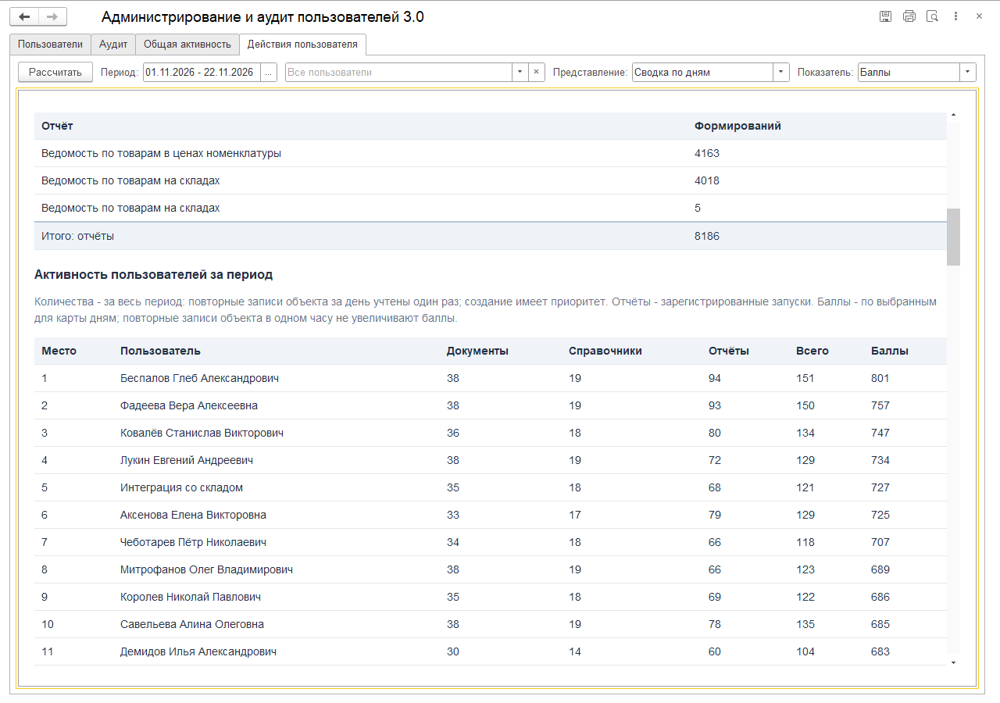
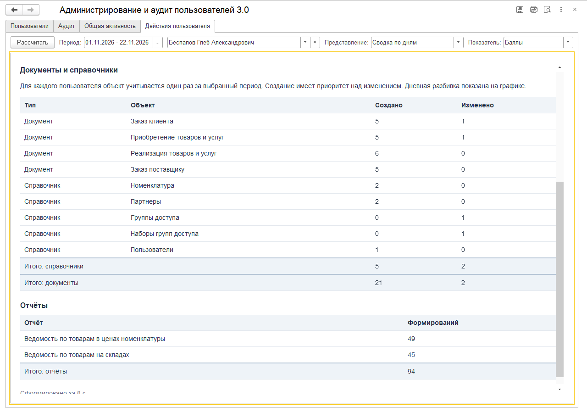
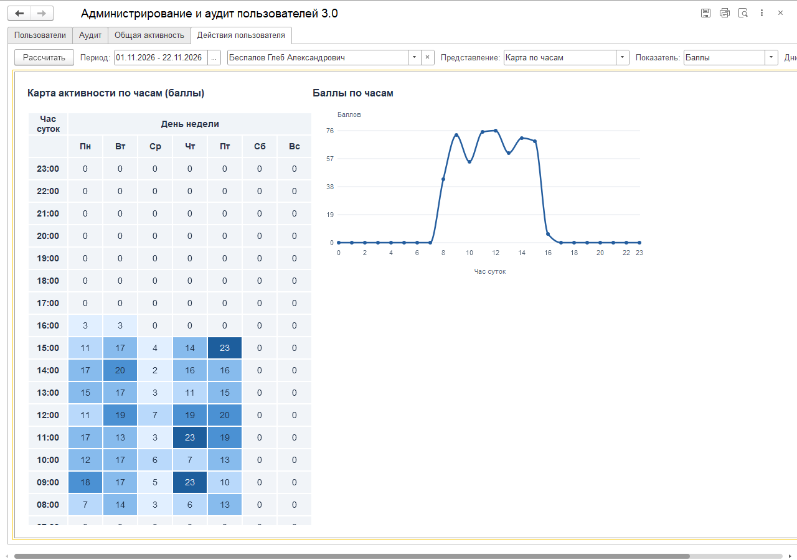
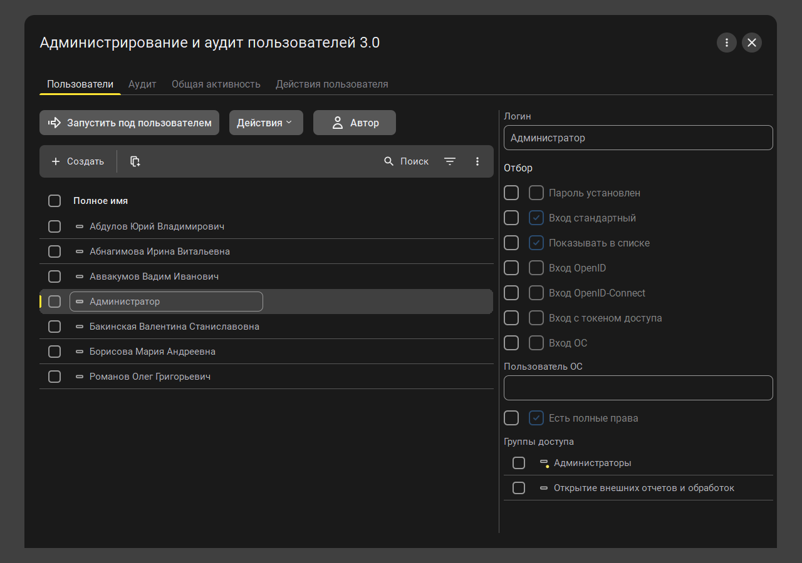

# Администрирование и аудит пользователей 1С — 3.0

На внедрении безопасность откладывают до запуска. После запуска — пока разберутся с доработками. Потом всё работает, и трогать страшно. Так в базе остаются полные права у половины пользователей и пароли, которые не менялись годами.

Обработка помогает увидеть эти проблемы, начать исправлять их и разобраться, как используется база. Один EPF для управляемых форм, без изменения конфигурации.

За первые 16 месяцев [публикация на Инфостарте](https://infostart.ru/1c/tools/2421332/) набрала **5 661 просмотр и 72 скачивания**. Опубликована 7 июля 2025 года, статистика на 15 ноября 2026 года.

Здесь собраны материалы к версии 3.0. Публичный выпуск готовится. [История версий](https://github.com/FFXEka/onec-user-admin/releases) · [Сообщить об ошибке](https://github.com/FFXEka/onec-user-admin/issues)

## Проверить безопасность

Общий аудит собирает замечания по учёткам, правам, способам входа и связям ИБ/БСП. Отдельный «Аудит паролей» находит распространённые и предсказуемые варианты. Из результата можно потребовать смену пароля или отключить стандартный вход; альтернативные способы входа видны рядом. У массовых действий есть прогресс и итог с изменениями, пропусками и ошибками.

**Собственная проверка SHA-1 работает с 8.3.10.** Дополнительная платформенная проверка доступна с 8.3.26. Найденный пароль показывается администратору, при проверке он не меняется. Для PBKDF2 используется сокращённый набор; отсутствие совпадений не доказывает надёжность пароля.

Аудит сохраняется в HTML с именем и путём базы. Два результата можно сравнить через «Было/Стало». Пароли и хеши в файл не включаются.

*В демобазе 13 учёток без пароля. В первой строке — администратор с полными правами.*

*Для одних пользователей смена пароля уже запрошена, для других её можно потребовать прямо из списка.*

## Не отключить работающий обмен

Пользователь может давно не открывать клиент 1С, но продолжать работать через интеграции. Расчёт прочей активности ищет веб-подключения HTTP/SOAP и COM за выбранный период. После расчёта общая рекомендация по блокировке пропускает учётки с обнаруженными подключениями. Перед отключением всё равно проверяем назначение учётки и полноту журнала.

## Быстро разобраться с пользователем

На вкладке «Пользователи» — список и отборы по правам и способам входа, копирование назначений, включение в группы и исключение из них в поддерживаемых механизмах БСП. Полное копирование прав «Документооборота 3.0» не поддерживается.

*Кому выданы полные права, видно по отбору справа. Из меню «Действия» можно включить пользователя в группу или скопировать ему права.*

Команда «Запустить под пользователем» помогает администратору воспроизвести проблему с настройками отчёта или списка в отдельном сеансе. Исходный сеанс потребуется до завершения операции.

Если исходный сеанс аварийно завершится до восстановления настроек входа, администратору может потребоваться сбросить пароль.

## Посмотреть активность

Пять примеров за 1–22 ноября сохранены из демобазы в HTML. По ссылке под снимком можно скачать файл и открыть весь отчёт в браузере.

«Общая активность» показывает пользователей по дням и средние значения, начало, окончание и длительность клиентских сеансов. Веб-подключения HTTP/SOAP и COM-соединения вынесены в отдельные колонки.

*За период в базу заходили 145 разных пользователей. На графике видно, как менялась посещаемость по дням.*

[Открыть полный отчёт по базе](demo/3.0/activity.html)

Средние за месяц, подключения и время сеансов

*В среднем за рабочий день — 125 пользователей. У обмена с Документооборотом за период 1 000 веб-подключений и ни одного входа в клиент.*

*У выбранного пользователя 23 входа за 18 дней. Ниже графика — длительность подтверждённых сеансов по датам.*

[Открыть отчёт по сеансам Родионова](demo/3.0/sessions.html)

«Действия пользователя» — документы, справочники, отчёты, распределение событий по часам и рейтинг действий за период. Фоновое формирование отчётов тоже учитывается.

*На графике — документы, справочники и отчёты по дням. Ниже видно, сколько заказов, поступлений и реализаций создали или изменили.*

[Открыть полную сводку действий](demo/3.0/actions.html)

По пользователям, видам объектов и часам

*В таблице можно сравнить число действий по пользователям. Документы, справочники, отчёты и баллы вынесены в отдельные колонки.*

*У одного пользователя за период создан 21 документ, изменены ещё два. Ниже — какие отчёты он запускал и сколько раз.*

[Открыть отчёт по действиям Беспалова](demo/3.0/user-actions.html)

*У этого пользователя основная активность приходится на промежуток с 8 до 16 часов. На карте можно посмотреть, как она распределяется по дням недели.*

[Открыть карту активности за 24 часа](demo/3.0/hourly.html)

Данные берутся из журнала регистрации. Они помогают разбирать загрузку пользователей, но длительность сеанса не равна рабочему времени, а количество событий само по себе не измеряет эффективность сотрудника.

## Начать работу

Для первой проверки откройте обработку на копии базы под администратором и выполните «Общий аудит». Для статистики нужен доступ к журналу регистрации. Перед массовыми изменениями проверьте выбранных пользователей и сохраните резервную копию базы.

Автор — Дмитрий Сушков, [FFXEka](https://github.com/FFXEka). Авторский код распространяется под [GPL-3.0-only](LICENSE). Уведомления о сторонних компонентах приведены в [THIRD_PARTY_NOTICES.md](THIRD_PARTY_NOTICES.md).

## Демо-стенд

Версия 3.0 проверена на 11 файловых и серверных базах: УТ, БП, ЗУП, Розница, ERP и демонстрационная БСП. Пройдено 218 нативных проверок и 418 сценариев интерфейса.

- **8.3.10.2772** — БСП 2.3.6.196.
- **8.3.18.1483** — БСП 3.1.3.523.
- **8.3.22.2411** — БСП 3.1.6.310, 3.1.7.526, 3.1.9.302 и 3.1.9.209.
- **8.3.24.1548** — БСП 3.1.11.283.
- **8.3.27.2325** — БСП 3.1.12.323, Linux.
- **8.5.1.1529** — БСП 3.1.12.348, 3.2.1.541 и 3.2.1.569.

Остальные строки — Windows. Нативные проверки выполнялись на поставочном EPF, интерфейсные — на сборках с тестовыми командами из тех же исходников. Доступность отдельных действий зависит от платформы и БСП.

Поддержан интерфейс 8.5 «Воздушный». Светлая и тёмная темы проверены на Рознице 3.0.14.202.

*Так выглядит вкладка «Пользователи» в тёмной теме «Воздушного» в Рознице 3.0.*
